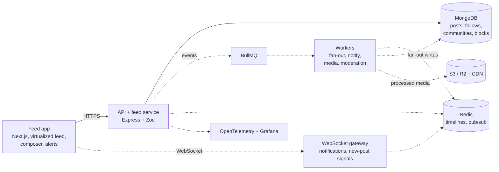

# Pulse

A social feed and communities app that stays fast, correct and private as it grows.

Built by [Yashwanth Varma](https://github.com/yashwanthvarma74-ai) with the
[Meridian design system](https://github.com/yashwanthvarma74-ai/designSystem).

> **Status: week 1 of 6 (feed basics).** The composer, the feed UI and the cursor model work and are tested.
> Everything else in the architecture below is planned and **not built yet**. See [what is built](#what-is-built).

## Architecture

The target design. Dashed boxes are not built yet.



### From publish to someone's screen (the plan)

1. You publish. The API validates the post, saves it to MongoDB and emits a `post_created` event.
2. The fan-out worker pushes the post ID into followers' Redis timelines, except for very large accounts, whose
   posts are pulled at read time.
3. The feed service merges pushed and pulled candidates, removes anything the viewer cannot see, ranks the rest and
   records why each item is there.
4. The notification worker saves one notification per event ID and pushes it through Redis pub/sub to the viewer's
   gateway.
5. The browser shows a "New posts" pill instead of jumping the feed; tapping it loads the freshly ranked list.

Today only step 1 exists, and the feed reads public posts newest first straight from MongoDB.

## What is built

| Area          | Done                                                                                             |
| ------------- | ------------------------------------------------------------------------------------------------ |
| Composer      | Text posts, 500 character limit with a live count, per-account drafts that survive a reload      |
| Feed          | Infinite scroll over cursor pages, empty, loading and error states                               |
| Cursor model  | Pages keyed on `(createdAt, _id)`, compound index, committed [query plans](docs/explain/feed.md) |
| Accounts      | One-click guest sessions (signed, http-only cookie), rate limited                                |
| Design system | Every component and colour comes from Meridian; light, dark and high contrast follow the system  |
| Tests and CI  | Unit, API integration against real MongoDB, a randomized paging test, axe; lint, types and build |

**Not built yet:** follows, communities, privacy rules and `canView()`, moderation, mentions, media, realtime
notifications, ranking and "Why am I seeing this?", fan-out, virtualization, Redis, workers, observability and the
performance numbers. The week-by-week plan is in the portfolio blueprint; each phase starts when the previous one
works end to end.

## Run it locally

You need Node 22+ and MongoDB (`brew tap mongodb/brew && brew install mongodb-community` on a Mac), running on
the default port.

```bash
cp .env.example .env
npm install
npm run seed -- --users 40 --posts 10000   # a synthetic dataset, see below
npm run dev                                 # web on :3000, API on :4001
```

Open <http://localhost:3000> and press **Continue as guest**. No sign up.

| Command             | What it does                                                        |
| ------------------- | ------------------------------------------------------------------- |
| `npm run dev`       | API and web app together                                            |
| `npm run seed`      | Replaces users and posts with synthetic data (`--users`, `--posts`) |
| `npm run explain`   | Re-runs the feed query plans and rewrites `docs/explain/feed.md`    |
| `npm run lint`      | ESLint and Prettier                                                 |
| `npm run typecheck` | Strict TypeScript in every workspace                                |
| `npm test`          | All tests (the API tests need MongoDB on `127.0.0.1:27017`)         |
| `npm run build`     | Production build of the API and the web app                         |

The seed data is 30 invented names and 50 short posts, spread over 30 days, with about one post in six sharing a
timestamp with another so the cursor's tie-break is exercised by real data.

## Measured so far

Apple M4 Pro, macOS 27, Node 26, MongoDB 9.0.2 on the same machine, 10,000 seeded posts.

| Check                                      | Result                                                       | How                                     |
| ------------------------------------------ | ------------------------------------------------------------ | --------------------------------------- |
| Duplicate or missing posts while paging    | **0** over 10,001 posts, 201 pages of 50                     | walked the feed through the running app |
| Feed query, first page and a page mid-feed | 21 and 23 index keys examined, 1 ms each, `IXSCAN` only      | `npm run explain`                       |
| Paging with inserts between pages          | 0 repeats or gaps across 40 randomized runs plus fixed cases | `apps/api/src/feed.test.ts`             |

The latency, FPS, memory and notification targets are not measured yet.

## Layout

```
pulse/
├─ apps/web/            Next.js feed app
├─ apps/api/            Express API, seed and explain scripts
├─ packages/shared/     types and Zod schemas used by both
├─ docs/adr/            decision records
├─ docs/explain/        committed query plans
└─ .github/workflows/   ci.yml
```

## Decisions

- [0001](docs/adr/0001-cursor-pagination.md) Cursor pagination on `(createdAt, _id)`
- [0002](docs/adr/0002-build-the-ui-with-the-design-system.md) Build the UI with the design system

## License

MIT
