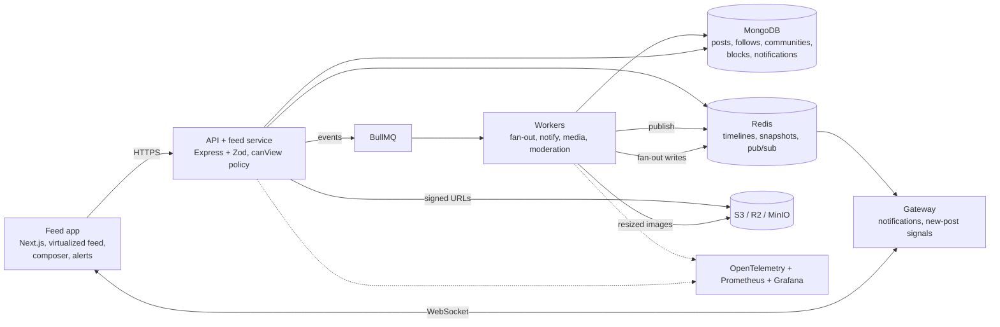

# Pulse

A social feed and communities app that stays fast, correct and private as it grows.

Built by [Yashwanth Varma](https://github.com/yashwanthvarma74-ai) with the
[Meridian design system](https://github.com/yashwanthvarma74-ai/designSystem).

> **Status.** All six build phases are written and tested on one machine. It is **not deployed**, `docker compose up`
> has **not been run**, and the **demo video is not recorded**. See [what is not done](#what-is-not-done).

## Try it in one minute

You need Node 22+, MongoDB and Redis running locally (`brew install redis` and
`brew tap mongodb/brew && brew install mongodb-community` on a Mac).

```bash
cp .env.example .env
npm install
npm run seed      # 13,000 posts, 1,500 fans, demo accounts
npm run dev       # web :3000, API :4001, worker
```

Open <http://localhost:3000>. Press **Continue as guest**, or pick a demo account and switch between them from the
account menu: Alice posts a followers-only message, Bob follows her and sees it, Carol does not, Dan is blocked.

## Architecture



The gateway is a module of the API process today (see [ADR 0009](docs/adr/0009-realtime-gateway.md)).

### From publish to someone's screen

1. You publish. The API validates the post, saves it with `unprocessed: true` and queues `post_created`.
2. The fan-out worker pushes the post id into followers' Redis timelines, except for accounts over 1,000
   followers, whose posts are pulled at read time.
3. The feed service merges pushed and pulled candidates, removes anything the viewer cannot see, ranks the rest and
   stores why each item is there.
4. The notification worker saves one notification per event id and publishes it through Redis to the viewer's socket.
5. The browser shows a "New posts" pill instead of jumping the feed; pressing it loads a freshly ranked list.

## What is built

| Phase       | Done                                                                                                                                                                                                                                                 |
| ----------- | ---------------------------------------------------------------------------------------------------------------------------------------------------------------------------------------------------------------------------------------------------- |
| Feed basics | Composer with drafts, images and mentions; infinite feed; `(createdAt, _id)` cursor model with compound indexes ([ADR 0001](docs/adr/0001-cursor-pagination.md))                                                                                     |
| Rules       | Follows, blocks, communities, replies, reactions, privacy settings, report and moderator queue, search; one visibility policy for every door ([0005](docs/adr/0005-one-visibility-policy.md))                                                        |
| Realtime    | BullMQ workers, replay-safe events, repair sweep, WebSocket gateway, image pipeline, "New posts" pill ([0007](docs/adr/0007-events-are-replay-safe.md), [0008](docs/adr/0008-images-processed-in-the-background.md))                                 |
| Scale       | Hybrid fan-out, Redis sorted-set timelines, ranked snapshot feed with stored reasons ([0003](docs/adr/0003-hybrid-fan-out.md), [0004](docs/adr/0004-redis-sorted-sets-for-timelines.md), [0006](docs/adr/0006-ranked-snapshot-and-latest-cursor.md)) |
| Harden      | Virtualized feed with the ARIA feed pattern, optimistic reactions with rollback, privacy property tests, queue replay tests, accessibility checks in three themes                                                                                    |
| Show        | Metrics, dashboard and alert rules, SLOs, threat model, budgets, Lighthouse and k6 scripts, CI                                                                                                                                                       |

## Key decisions

[All records](docs/adr): cursor pagination, the design system, hybrid fan-out, sorted-set timelines, one visibility
policy, ranked snapshots, replay-safe events, background image processing, the gateway, keeping validation out of the
browser, and what happens when a dependency is away.

## Benchmarks and how to reproduce them

Measured on an Apple M4 Pro, local MongoDB and Redis, headless Chromium. Full table and caveats:
[docs/BENCHMARKS.md](docs/BENCHMARKS.md).

| Target                                  | Result                                                                        |
| --------------------------------------- | ----------------------------------------------------------------------------- |
| Feed first page, p95                    | ranked 86 ms, latest 22 ms (k6, 20 users)                                     |
| Duplicate or missing posts while paging | 0 and 0 (668 posts published during the read)                                 |
| Notification delivery, p95              | 18 ms                                                                         |
| Scroll 10,000 posts                     | 60 fps, at most 17 posts in the DOM; heap grows 5.5 to 41.7 MB (**not flat**) |
| Unauthorized items shown                | 0                                                                             |
| Home route first-load JS                | 279 to 174 KB gzipped; mobile LCP unchanged at 3.6 s                          |

```bash
perf/stack.sh start            # production-like stack on its own database
source perf/env.sh
k6 run perf/k6/feed.js
node perf/paging.mjs && node perf/delivery.mjs && node perf/scroll.mjs
node perf/lighthouse.mjs && npm run size
```

## Failure modes

See [ADR 0011](docs/adr/0011-failure-handling.md). In short: with Redis away the API stays up and serves the
newest-first feed from MongoDB; posts are fanned out later by the repair sweep.

## What changes at 10x and 100x

- **Viewer context** (follows, blocks, communities) is three reads per request; it would be cached.
- **Timelines** are capped at 1,000 entries and the ranked pool at 300; deeper scrolling would need a second tier.
- **Gateway** would be split from the API and scaled by socket count.
- **Rate limits** are in process memory and would move into Redis.
- **Memory** in the browser grows with loaded posts; dropping pages far above the viewport is the next step.
- **Mobile LCP** is bounded by JavaScript, session and feed loading in turn; server-rendering the first page is next.

## Tests and checks

`npm run lint`, `npm run typecheck`, `npm test` (unit and integration, real MongoDB and Redis), `npm run e2e`
(Playwright against the real stack), `npm run test:coverage`, `npm run size`. 220 tests; the core logic is at 96% lines.
Docs: [SLOs](docs/SLOS.md), [threat model](docs/THREAT-MODEL.md), [accessibility](docs/ACCESSIBILITY.md),
[query plans](docs/explain/queries.md), [deploy plan](docs/DEPLOY.md), [demo script](docs/DEMO-SCRIPT.md).

## What is not done

- Not deployed; no live link. [docs/DEPLOY.md](docs/DEPLOY.md) is a plan, not a record.
- `docker-compose.yml` and the Dockerfiles have never been run (no Docker on the build machine).
- The demo video is not recorded.
- No screen reader pass on real devices.
- Metrics only, no distributed traces.
- Images only, no video.

## Layout

```
pulse/
├─ apps/web/          Next.js app          ├─ infra/         compose, Prometheus, Grafana
├─ apps/api/          Express API, gateway ├─ perf/          load, scroll, delivery, Lighthouse
├─ apps/worker/       BullMQ workers       ├─ e2e/           Playwright tests
├─ packages/core/     domain logic         ├─ docs/          ADRs, SLOs, plans, benchmarks
└─ packages/shared/   types and schemas    └─ .github/       ci.yml, dependabot
```

MIT
